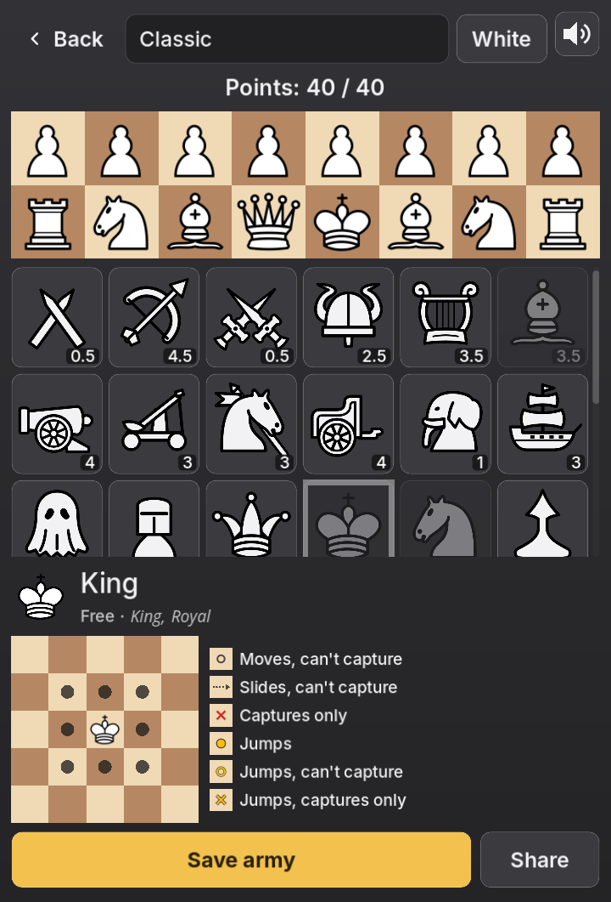
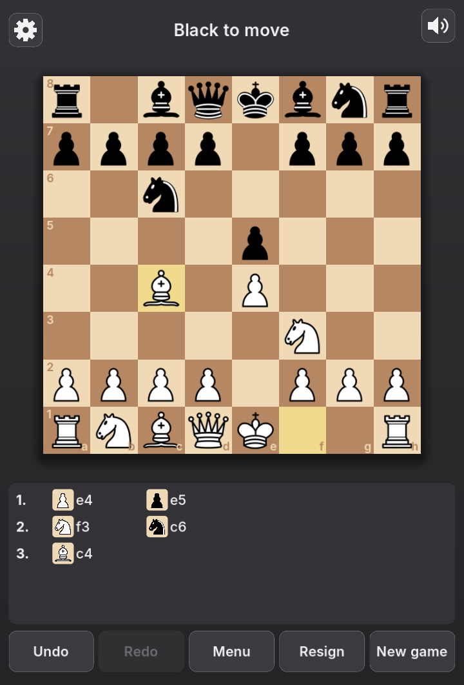

# Overchess

Chess where you build your own army. Spend 40 points on pieces - the classic
six, or 27 new ones with their own moves, shields, walls and once-a-game
abilities - set them up on your two rows, and play: against a friend on one
device, against the computer, or online with a code or a quick match.

**Play it now:** https://thedarkhorse99.github.io/ChessPlus/ (phone or
desktop browser; on iPhone, Share -> Add to Home Screen for a full-screen app).

| Building an army | A game |
|---|---|
|  |  |

## How to play

1. **Build an army:** 40 points, your two rows, exactly one King in the middle
   of the back row, at most two of any piece, pawn types without limit. Tap a
   piece in the builder to see its card.
2. **Pick armies and play.** White's first move can't capture.
3. **Special abilities and promotion** need the piece to have moved once.
4. **Draws:** the 50-move rule, threefold repetition, and 75 moves with no
   change to the pieces.
5. **Everything else is chess:** check, checkmate, castling, en passant.

## The pieces

| Piece | Cost | Piece | Cost | Piece | Cost |
|---|---|---|---|---|---|
| Queen | 10 | Jester | 3.5 | Ram | 3 |
| Princess | 8.5 | Necromancer | 3.5 | Werewolf | 3 |
| Wizard | 8.5 | Rogue | 3.5 | Barbarian | 2.5 |
| Vampire | 7.5 | Catapult | 3 | Parapet | 2.5 |
| Archer | 4.5 | Cavalry | 3 | Paladin | 1.5 |
| Rook | 4.5 | Galleon | 3 | Elephant | 1 |
| Cannon | 4 | Ghost | 3 | Grunt | 1 |
| Chariot | 4 | Knight | 3 | Pawn | 1 |
| Squire | 4 | Lance | 3 | Vassal | 1 |
| Bard | 3.5 | Man | 3 | Abatis | 0.5 |
| Bishop | 3.5 | | | Assassin | 0.5 |

The King is free; every army has exactly one. Each piece's card in the game
shows its moves and rules.

## Credits

- Chess piece art: [Cburnett](https://commons.wikimedia.org/wiki/Category:SVG_chess_pieces),
  CC BY-SA 3.0; the new pieces are drawn in the same style.
- Fonts: Inter and Open Sans Italic (SIL Open Font License 1.1).
- Sounds: Kenney (CC0), with recordings by Lomond (CC BY 3.0), Jud McCranie
  (CC BY-SA 4.0), Pete w. View (CC BY-SA 4.0), Coro Santa Pazienza (CC BY 3.0),
  IgnasD (CC0) and public-domain wildlife recordings; details beside each
  file in `audio/sfx/`.
- Analysis engine: Plusfish, by Nicholas McG.

## Open source

Made with Godot 4 (GDScript); the analysis engine is Rust. The code is all
here; its licence file is still to be added. Art and sound are under the
licences credited above. Bug reports and ideas:
[issues](https://github.com/thedarkhorse99/ChessPlus/issues), or come and talk
on [Discord](https://discord.gg/Z7dyqquC94).
